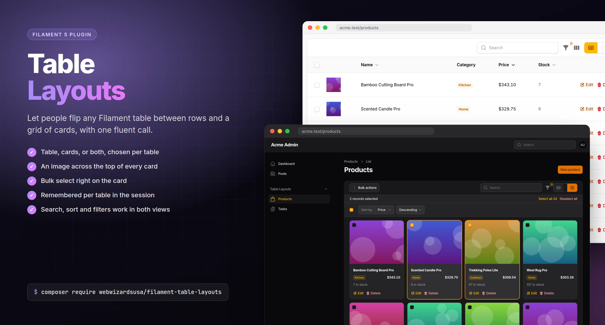
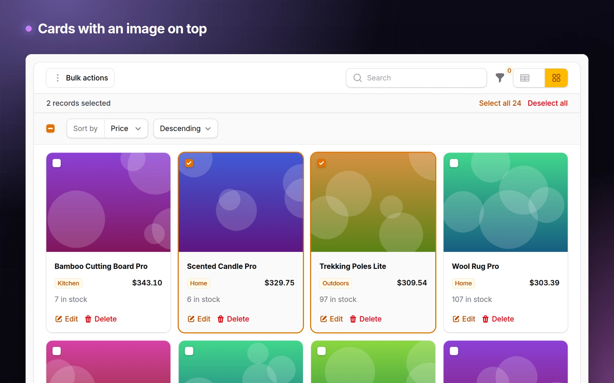
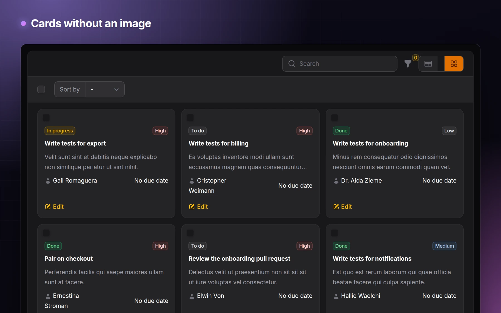
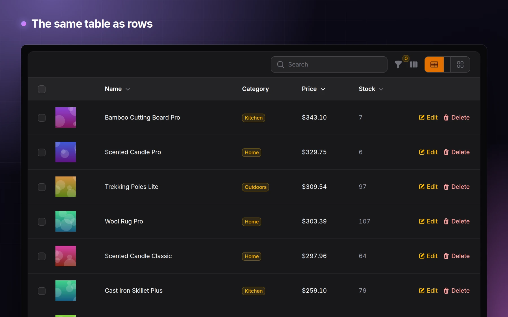

# Filament Table Layouts

> **Under active development.** This package is still changing and may not be ready for production use yet. Until
> 1.0, a minor release can include breaking changes, so check the changelog before you upgrade.



[](https://packagist.org/packages/webwizardsusa/filament-table-layouts)
[](https://github.com/webwizardsusa/filament-table-layouts/actions/workflows/tests.yml)
[](https://packagist.org/packages/webwizardsusa/filament-table-layouts/stats)
[](https://packagist.org/packages/webwizardsusa/filament-table-layouts)
[](https://filamentphp.com)
[](https://github.com/webwizardsusa/filament-table-layouts/blob/main/LICENSE.md)

Let people switch a Filament table between rows and a grid of cards, with a switcher in the table's toolbar. Each card
has an image across the top, the details below it, then the record actions, with the bulk select checkbox over the top
left corner. The layout someone picks is remembered in their session, for each table.

<p align="center">
  
  
  
</p>

Requires PHP 8.3+ and Filament 5.

```bash
composer require webwizardsusa/filament-table-layouts
```

```php
use Webwizardsusa\TableLayouts\Card;

public static function table(Table $table): Table
{
    return $table
        ->columns([
            ImageColumn::make('cover'),
            TextColumn::make('title')->searchable()->sortable(),
            TextColumn::make('author.name'),
        ])
        ->card(
            Card::make([
                TextColumn::make('title')->weight(FontWeight::Bold),
                TextColumn::make('author.name')->color('gray'),
            ])->image('cover'),
        );
}
```

Defining a card offers both layouts, starting in the table. To start in cards, or offer only cards:

```php
use Webwizardsusa\TableLayouts\Enums\TableLayout;

$table->card($card)->defaultLayout(TableLayout::Card);
$table->card($card)->availableLayouts(TableLayout::Card);
```

The full documentation is in [docs/](docs/introduction.md).

## Testing

```bash
composer test
```

## About Us

This package is developed and maintained by [WebWizardsUSA](https://webwizardsusa.com/), a top rated web development agency on Upwork.

## License

The MIT License (MIT). See [LICENSE.md](LICENSE.md).
