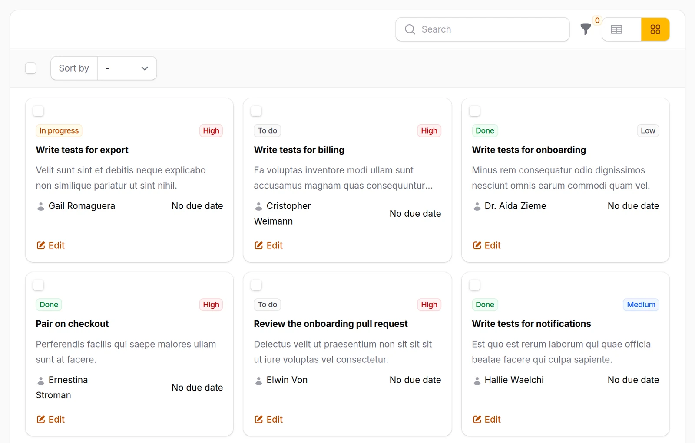

A `Card` is a column layout, like Filament's `Stack` or `Split`: its schema is the columns and layouts shown under the
image, one under the other.

```php
use Filament\Tables\Columns\Layout\Split;
use Webwizardsusa\TableLayouts\Card;

Card::make([
    TextColumn::make('title')->weight(FontWeight::Bold),
    Split::make([
        TextColumn::make('author.name')->color('gray'),
        TextColumn::make('published_at')->date()->alignEnd(),
    ]),
])
```

The record actions are shown below the details, and the table's record URL or record action applies to the whole
card.

## The image

`image()` takes the name of an attribute holding the image's path or URL, which becomes an `ImageColumn`, or a column
of your own, for a disk, a default image or a computed URL:

```php
Card::make([...])->image('cover');

Card::make([...])->image(
    ImageColumn::make('cover')->disk('s3')->visibility('private')->defaultImageUrl(url('placeholder.png')),
);

Card::make([...])->image(
    ImageColumn::make('thumbnail')->state(fn (Image $record): string => $record->url('card')),
);
```

The image covers the area at the top of the card, cropped to fit. Its height is `12rem` unless you change it:

```php
Card::make([...])->image('cover')->imageHeight('16rem');
```

Without an image, the card starts with its details:



## The grid

`grid()` sets the number of cards across per breakpoint, as Filament's `contentGrid()` does. An int is that many from
the `md` breakpoint up, and one below it. The default is one, two from `md` and three from `xl`.

```php
Card::make([...])->grid(['default' => 1, 'sm' => 2, 'lg' => 3, 'xl' => 4]);

Card::make([...])->grid(3);
```
