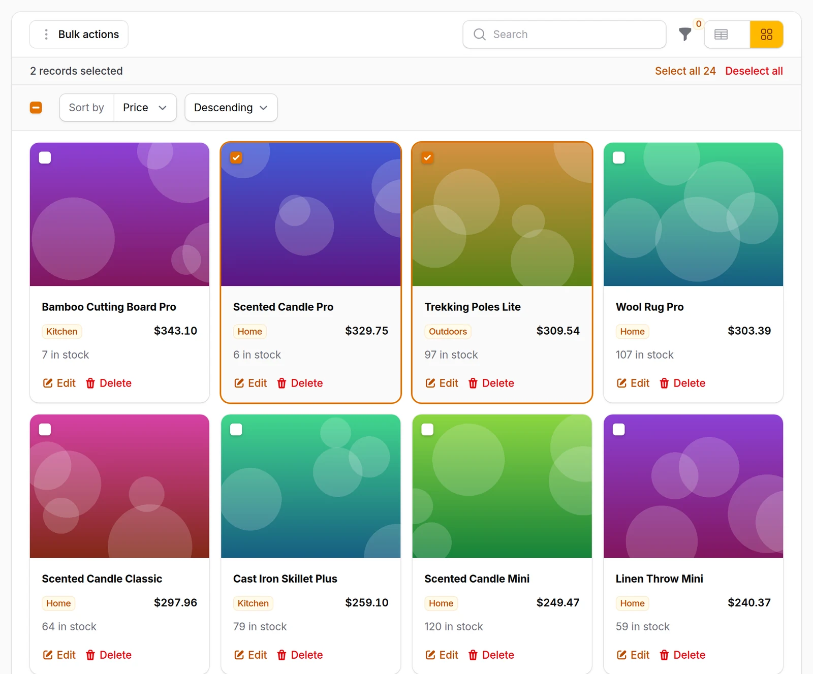

Filament Table Layouts lets people switch a table between its usual rows and a grid of cards. A switcher at the end of
the table's toolbar shows one button per layout; the layout someone picks is remembered in their session, separately
for each table.

Each card has an optional image across the top, then the details, then the record actions. When the table has bulk
actions, the select checkbox sits over the card's top left corner.



## A short example

```php
use Filament\Support\Enums\FontWeight;
use Filament\Tables\Columns\ImageColumn;
use Filament\Tables\Columns\TextColumn;
use Filament\Tables\Table;
use Webwizardsusa\TableLayouts\Card;

public static function table(Table $table): Table
{
    return $table
        ->columns([
            ImageColumn::make('cover'),
            TextColumn::make('title')->searchable()->sortable(),
            TextColumn::make('author.name'),
        ])
        ->card(
            Card::make([
                TextColumn::make('title')->weight(FontWeight::Bold),
                TextColumn::make('author.name')->color('gray'),
            ])
                ->image('cover')
                ->grid(['md' => 2, 'xl' => 4]),
        );
}
```

There is nothing to add to the page or resource: the package works on any table, in resources, relation managers,
widgets and your own Livewire components.

## Requirements

- PHP 8.3 or newer
- Filament 5
